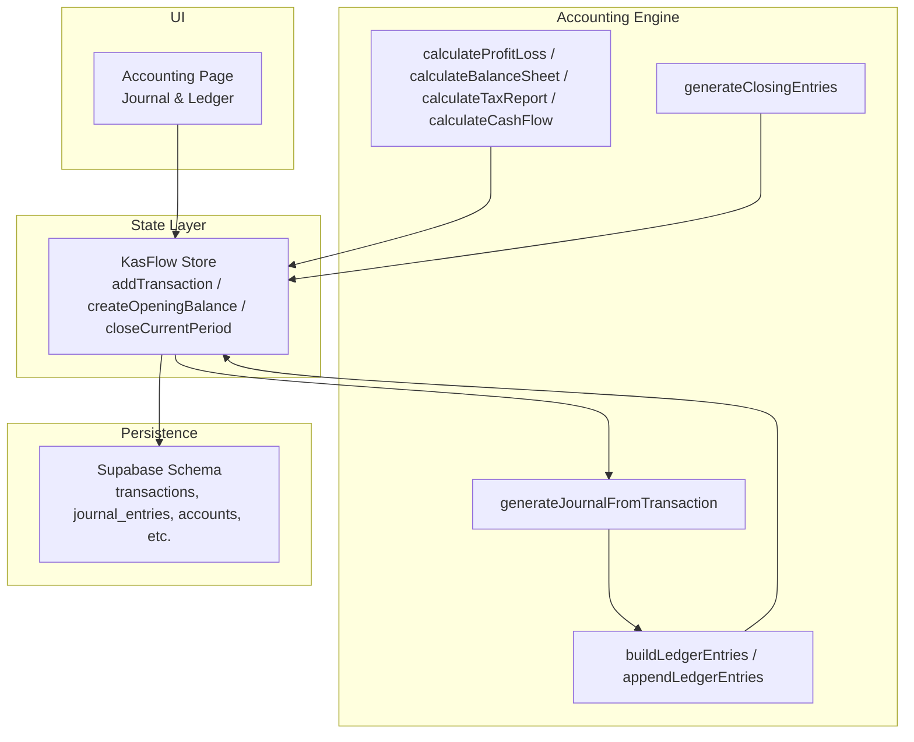
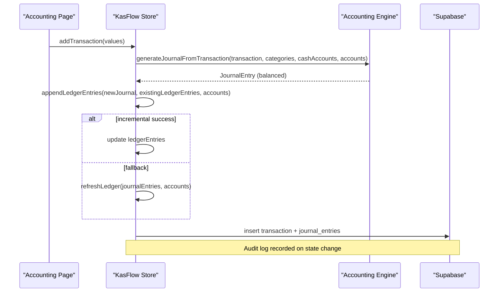
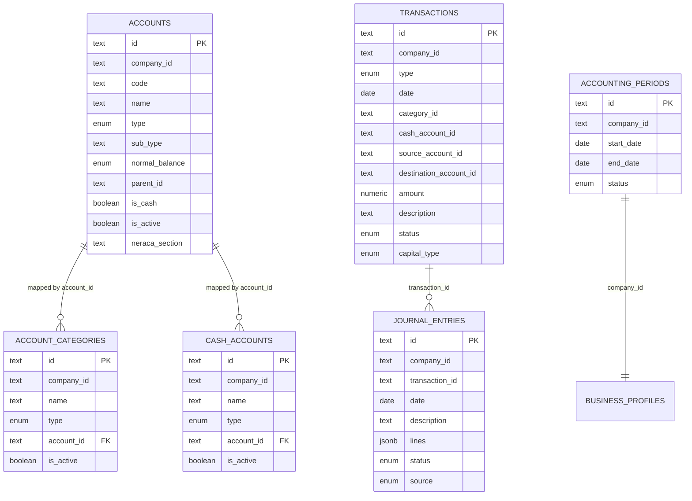
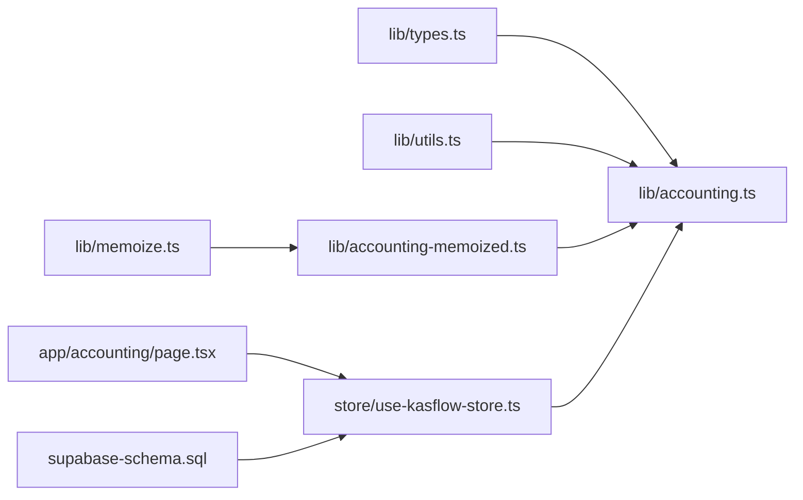

# Core Accounting System

<cite>
**Referenced Files in This Document**
- [lib/accounting.ts](file://lib/accounting.ts)
- [lib/accounting-memoized.ts](file://lib/accounting-memoized.ts)
- [lib/types.ts](file://lib/types.ts)
- [store/use-kasflow-store.ts](file://store/use-kasflow-store.ts)
- [app/accounting/page.tsx](file://app/accounting/page.tsx)
- [supabase-schema.sql](file://supabase-schema.sql)
</cite>

## Table of Contents
1. [Introduction](#introduction)
2. [Project Structure](#project-structure)
3. [Core Components](#core-components)
4. [Architecture Overview](#architecture-overview)
5. [Detailed Component Analysis](#detailed-component-analysis)
6. [Dependency Analysis](#dependency-analysis)
7. [Performance Considerations](#performance-considerations)
8. [Troubleshooting Guide](#troubleshooting-guide)
9. [Conclusion](#conclusion)

## Introduction
This document explains the ledger-first accounting engine that powers double-entry bookkeeping automation. It covers how transactions are validated, how journal entries are generated automatically, and how the ledger is maintained with running balances. It also documents the relationship between transaction management, reporting, and period closing, including capital transactions (owner’s capital, drawings, dividends). The content provides both conceptual overviews for beginners and technical details for developers implementing custom accounting rules.

## Project Structure
The core accounting system is implemented primarily in:
- lib/accounting.ts: Journal generation, ledger building, profit/loss, balance sheet, tax report, cash flow, and closing entries.
- lib/accounting-memoized.ts: Memoized wrappers for expensive calculations to improve performance.
- lib/types.ts: Shared types for accounts, categories, transactions, journals, ledgers, reports, and more.
- store/use-kasflow-store.ts: Client-side state management orchestrating transaction creation, journal persistence, and ledger updates.
- app/accounting/page.tsx: UI for general journal, ledger per account, chart of accounts, and period close/open operations.
- supabase-schema.sql: Database schema for accounts, categories, cash accounts, transactions, journal entries, periods, and related tables.

**Diagram sources**
- [app/accounting/page.tsx:103-147](file://app/accounting/page.tsx#L103-L147)
- [store/use-kasflow-store.ts:330-384](file://store/use-kasflow-store.ts#L330-L384)
- [lib/accounting.ts:152-256](file://lib/accounting.ts#L152-L256)
- [lib/accounting.ts:258-347](file://lib/accounting.ts#L258-L347)
- [lib/accounting.ts:404-554](file://lib/accounting.ts#L404-L554)
- [lib/accounting.ts:566-702](file://lib/accounting.ts#L566-L702)
- [supabase-schema.sql:182-244](file://supabase-schema.sql#L182-L244)

**Section sources**
- [lib/accounting.ts:152-256](file://lib/accounting.ts#L152-L256)
- [lib/accounting.ts:258-347](file://lib/accounting.ts#L258-L347)
- [lib/accounting.ts:404-554](file://lib/accounting.ts#L404-L554)
- [lib/accounting.ts:566-702](file://lib/accounting.ts#L566-L702)
- [lib/accounting-memoized.ts:23-75](file://lib/accounting-memoized.ts#L23-L75)
- [store/use-kasflow-store.ts:330-384](file://store/use-kasflow-store.ts#L330-L384)
- [app/accounting/page.tsx:103-147](file://app/accounting/page.tsx#L103-L147)
- [supabase-schema.sql:182-244](file://supabase-schema.sql#L182-L244)

## Core Components
- Transaction model: Represents income, expense, transfer, and capital events with date, amount, category, and cash accounts.
- Chart of Accounts (COA): Defines accounts with type, normal balance, optional parent, and neraca section classification.
- Categories: Groupings mapping to revenue or expense accounts for easier transaction entry.
- Cash Accounts: Logical cash/bank/e-wallet entities mapped to COA accounts.
- Journal Entries: Double-entry records with lines containing debit/credit per account.
- Ledger Entries: Per-account chronological entries with running balances.
- Reports: Profit/Loss, Balance Sheet, Tax Report, Cash Flow, and summary metrics.
- Period Management: Open/closed accounting periods with closing entries.

Key responsibilities:
- Validate transactions against closed periods and business rules.
- Generate balanced journal entries automatically from transactions.
- Maintain ledger entries with correct running balances.
- Compute financial statements and tax estimates.
- Support period closing by zeroing temporary accounts into retained earnings.

**Section sources**
- [lib/types.ts:26-139](file://lib/types.ts#L26-L139)
- [lib/accounting.ts:26-125](file://lib/accounting.ts#L26-L125)
- [lib/accounting.ts:152-256](file://lib/accounting.ts#L152-L256)
- [lib/accounting.ts:258-347](file://lib/accounting.ts#L258-L347)
- [lib/accounting.ts:404-554](file://lib/accounting.ts#L404-L554)
- [lib/accounting.ts:713-892](file://lib/accounting.ts#L713-L892)
- [lib/accounting.ts:894-983](file://lib/accounting.ts#L894-L983)
- [lib/accounting.ts:566-702](file://lib/accounting.ts#L566-L702)

## Architecture Overview
The system follows a ledger-first design:
- Transactions are user-facing inputs.
- Journals are the source of truth for all accounting data.
- Ledgers are derived from journals and provide per-account running balances.
- Reports are computed from journals and accounts.

**Diagram sources**
- [store/use-kasflow-store.ts:330-384](file://store/use-kasflow-store.ts#L330-L384)
- [lib/accounting.ts:152-256](file://lib/accounting.ts#L152-L256)
- [lib/accounting.ts:296-347](file://lib/accounting.ts#L296-L347)
- [supabase-schema.sql:182-244](file://supabase-schema.sql#L182-L244)

## Detailed Component Analysis

### Transaction Validation Rules
- Closed period guard: Transactions cannot be added if their date falls within a closed accounting period.
- Transfer validation: Source and destination must be different valid cash accounts.
- Capital validation: Requires a valid cash account; capitalType must be one of setoran, prive, dividen.
- Amount and description constraints enforced at form level before reaching the engine.

Implementation highlights:
- Closed period check uses accounting periods status and date ranges.
- Transfer requires distinct source and destination cash accounts.
- Capital transaction routing depends on capitalType and maps to specific equity accounts.

**Section sources**
- [store/use-kasflow-store.ts:330-336](file://store/use-kasflow-store.ts#L330-L336)
- [lib/accounting.ts:189-201](file://lib/accounting.ts#L189-L201)
- [lib/accounting.ts:203-235](file://lib/accounting.ts#L203-L235)

### Journal Entry Creation Logic
The engine generates balanced journal entries based on transaction type:
- Income: Debit cash/bank account; Credit revenue account.
- Expense: Debit expense account; Credit cash/bank account.
- Transfer: Debit destination cash account; Credit source cash account.
- Capital:
  - Setoran (capital deposit): Debit cash/bank; Credit owner’s capital (account code 3100).
  - Prive (drawings): Debit drawings (account code 3200); Credit cash/bank.
  - Dividen (dividends): Debit retained earnings (account code 3300); Credit cash/bank.

Balancing enforcement:
- Sum of debits must equal sum of credits; otherwise an error is thrown.

Public interface:
- Function: generateJournalFromTransaction
- Parameters:
  - transaction: Transaction object
  - categories: Category[]
  - cashAccounts: CashAccount[]
  - accounts: Account[] (optional, used for resolving prefixed IDs)
- Returns: JournalEntry with status posted and source set appropriately.

Error handling:
- Throws descriptive errors when required fields are missing or invalid.

**Section sources**
- [lib/accounting.ts:152-256](file://lib/accounting.ts#L152-L256)

### Account Balancing Mechanisms
Two mechanisms maintain ledger balances:
- Full rebuild: buildLedgerEntries sorts active journals chronologically and computes running balances per account.
- Incremental append: appendLedgerEntries attempts to compute new entries only for the latest journal; returns null if not the latest, triggering a full rebuild.

Complexity:
- Full rebuild: O(J*L) where J is number of journals and L is average lines per journal.
- Incremental append: O(L_new) plus O(N) to map last balances once.

Normal balance handling:
- Movement calculation respects account.normalBalance to ensure consistent sign conventions across asset/liability/equity/revenue/expense accounts.

Public interfaces:
- buildLedgerEntries(journals, accounts): LedgerEntry[]
- appendLedgerEntries(newJournal, existingLedgerEntries, accounts): LedgerEntry[] | null

**Section sources**
- [lib/accounting.ts:258-347](file://lib/accounting.ts#L258-L347)

### Reporting Functions
- Profit/Loss: Aggregates revenue and expenses by account and subType, computes gross profit, operating expenses, EBIT, non-operating items, EBT, explicit tax expense, estimated tax, and net profit. Also provides by-account breakdowns and category-level detail.
- Balance Sheet: Groups accounts by neraca sections, sums balances, includes retained earnings and current-period components, and validates balance equality.
- Tax Report: Computes estimated tax based on tax settings (rate, base), due date, and period.
- Cash Flow: Aggregates monthly income and expense movements from journals.
- Report Summary: Combines P&L, balance sheet, and cash totals for dashboard metrics.

Memoization:
- Memoized versions reduce recomputation costs for repeated calls with same parameters.

Public interfaces:
- calculateProfitLoss(journals, accounts, from?, to?, transactions?, taxSettings?): ProfitLossReport
- calculateBalanceSheet(journals, accounts, taxSettings?, accountingPeriods?): BalanceSheetReport
- calculateTaxReport(journals, accounts, taxSettings, period?): TaxReport
- calculateCashFlow(journals, accounts): CashFlowPoint[]
- calculateReportSummary(journals, accounts, cashAccounts, taxSettings, from?, to?): ReportSummary

**Section sources**
- [lib/accounting.ts:404-554](file://lib/accounting.ts#L404-L554)
- [lib/accounting.ts:713-892](file://lib/accounting.ts#L713-L892)
- [lib/accounting.ts:894-983](file://lib/accounting.ts#L894-L983)
- [lib/accounting-memoized.ts:23-75](file://lib/accounting-memoized.ts#L23-L75)

### Period Closing and Retained Earnings
Closing entries zero out temporary accounts into retained earnings (account code 3400):
- Close revenue accounts → credit retained earnings.
- Close expense accounts → debit retained earnings.
- Close drawings (prive) → debit retained earnings.
- Close dividends → debit retained earnings.

Net effect on retained earnings equals net profit minus drawings and dividends.

Public interface:
- generateClosingEntries(companyId, periodStartDate, periodEndDate, journals, accounts): JournalEntry[]

**Section sources**
- [lib/accounting.ts:566-702](file://lib/accounting.ts#L566-L702)

### Practical Examples
- Income recording:
  - Input: type = income, categoryId linked to revenue account, cashAccountId linked to cash/bank.
  - Output: Debit cash/bank, Credit revenue; balanced journal created.
- Expense processing:
  - Input: type = expense, categoryId linked to expense account, cashAccountId linked to cash/bank.
  - Output: Debit expense, Credit cash/bank; balanced journal created.
- Transfer operations:
  - Input: type = transfer, sourceAccountId and destinationAccountId distinct cash accounts.
  - Output: Debit destination cash, Credit source cash; balanced journal created.
- Capital transactions:
  - Setoran: Debit cash/bank, Credit owner’s capital (3100).
  - Prive: Debit drawings (3200), Credit cash/bank.
  - Dividen: Debit retained earnings (3300), Credit cash/bank.

These flows are enforced by generateJournalFromTransaction and validated by appendLedgerEntries/buildLedgerEntries.

**Section sources**
- [lib/accounting.ts:152-256](file://lib/accounting.ts#L152-L256)

### Public Interfaces Summary
- generateJournalFromTransaction(transaction, categories, cashAccounts, accounts?): JournalEntry
- buildLedgerEntries(journals, accounts): LedgerEntry[]
- appendLedgerEntries(newJournal, existingLedgerEntries, accounts): LedgerEntry[] | null
- calculateProfitLoss(journals, accounts, from?, to?, transactions?, taxSettings?): ProfitLossReport
- calculateBalanceSheet(journals, accounts, taxSettings?, accountingPeriods?): BalanceSheetReport
- calculateTaxReport(journals, accounts, taxSettings, period?): TaxReport
- calculateCashFlow(journals, accounts): CashFlowPoint[]
- calculateReportSummary(journals, accounts, cashAccounts, taxSettings, from?, to?): ReportSummary
- generateClosingEntries(companyId, periodStartDate, periodEndDate, journals, accounts): JournalEntry[]

Return values include structured reports with totals and detailed breakdowns. Errors are thrown for invalid inputs or unbalanced journals.

**Section sources**
- [lib/accounting.ts:152-256](file://lib/accounting.ts#L152-L256)
- [lib/accounting.ts:258-347](file://lib/accounting.ts#L258-L347)
- [lib/accounting.ts:404-554](file://lib/accounting.ts#L404-L554)
- [lib/accounting.ts:713-892](file://lib/accounting.ts#L713-L892)
- [lib/accounting.ts:894-983](file://lib/accounting.ts#L894-L983)
- [lib/accounting.ts:566-702](file://lib/accounting.ts#L566-L702)

### Data Model Relationships

**Diagram sources**
- [supabase-schema.sql:75-136](file://supabase-schema.sql#L75-L136)
- [supabase-schema.sql:182-244](file://supabase-schema.sql#L182-L244)
- [supabase-schema.sql:270-286](file://supabase-schema.sql#L270-L286)

## Dependency Analysis
- Store depends on accounting functions for journal generation and ledger updates.
- Accounting functions depend on types and utilities (date helpers, memoize).
- UI interacts with store actions and displays journal and ledger views.
- Supabase schema enforces referential integrity and RLS policies.

**Diagram sources**
- [lib/accounting.ts:1-22](file://lib/accounting.ts#L1-L22)
- [lib/accounting-memoized.ts:1-22](file://lib/accounting-memoized.ts#L1-L22)
- [store/use-kasflow-store.ts:1-22](file://store/use-kasflow-store.ts#L1-L22)
- [app/accounting/page.tsx:1-40](file://app/accounting/page.tsx#L1-L40)
- [supabase-schema.sql:1-10](file://supabase-schema.sql#L1-L10)

**Section sources**
- [lib/accounting.ts:1-22](file://lib/accounting.ts#L1-L22)
- [lib/accounting-memoized.ts:1-22](file://lib/accounting-memoized.ts#L1-L22)
- [store/use-kasflow-store.ts:1-22](file://store/use-kasflow-store.ts#L1-L22)
- [app/accounting/page.tsx:1-40](file://app/accounting/page.tsx#L1-L40)
- [supabase-schema.sql:1-10](file://supabase-schema.sql#L1-L10)

## Performance Considerations
- Incremental ledger updates: appendLedgerEntries avoids full rebuilds for the common case of appending the latest journal.
- Memoization: Expensive report calculations are cached with configurable cache sizes to reduce recomputation.
- Sorting and filtering: Journals are filtered by deletedAt and status, then sorted by date/id to ensure deterministic ledger order.
- Indexes: Database indexes on company_id, date, and other columns support efficient queries for large datasets.

Recommendations:
- Prefer incremental ledger updates when possible.
- Use memoized report functions for repeated computations.
- Keep journal entries ordered by date to maximize incremental efficiency.

[No sources needed since this section provides general guidance]

## Troubleshooting Guide
Common issues and resolutions:
- “Periode akuntansi sudah ditutup”: Ensure the transaction date is not within a closed period; open a new period or adjust the date.
- “Transfer harus memiliki akun sumber dan tujuan yang berbeda”: Verify source and destination cash accounts are distinct.
- “Transaksi modal harus memiliki akun kas yang valid”: Confirm cashAccountId is provided for capital transactions.
- “Jurnal tidak balance”: Check that debits equal credits; review category mappings and amounts.
- Backdated transactions causing ledger mismatch: The system will fall back to full rebuild; verify ordering and ensure no gaps in dates.

Operational checks:
- Confirm accounts exist and are active.
- Validate categories map to correct accounts.
- Review audit logs for recent changes.

**Section sources**
- [store/use-kasflow-store.ts:330-336](file://store/use-kasflow-store.ts#L330-L336)
- [lib/accounting.ts:189-201](file://lib/accounting.ts#L189-L201)
- [lib/accounting.ts:203-235](file://lib/accounting.ts#L203-L235)
- [lib/accounting.ts:240-242](file://lib/accounting.ts#L240-L242)

## Conclusion
The ledger-first accounting engine ensures accurate double-entry bookkeeping by validating transactions, generating balanced journal entries, maintaining running balances, and producing comprehensive financial reports. Its modular design supports extensibility for custom accounting rules while providing robust performance through incremental ledger updates and memoized calculations. The system integrates seamlessly with UI workflows and database persistence, enabling reliable accounting operations for small businesses.