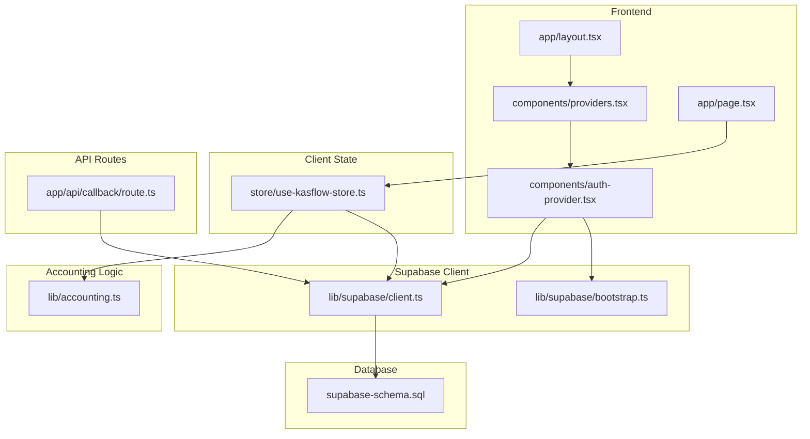
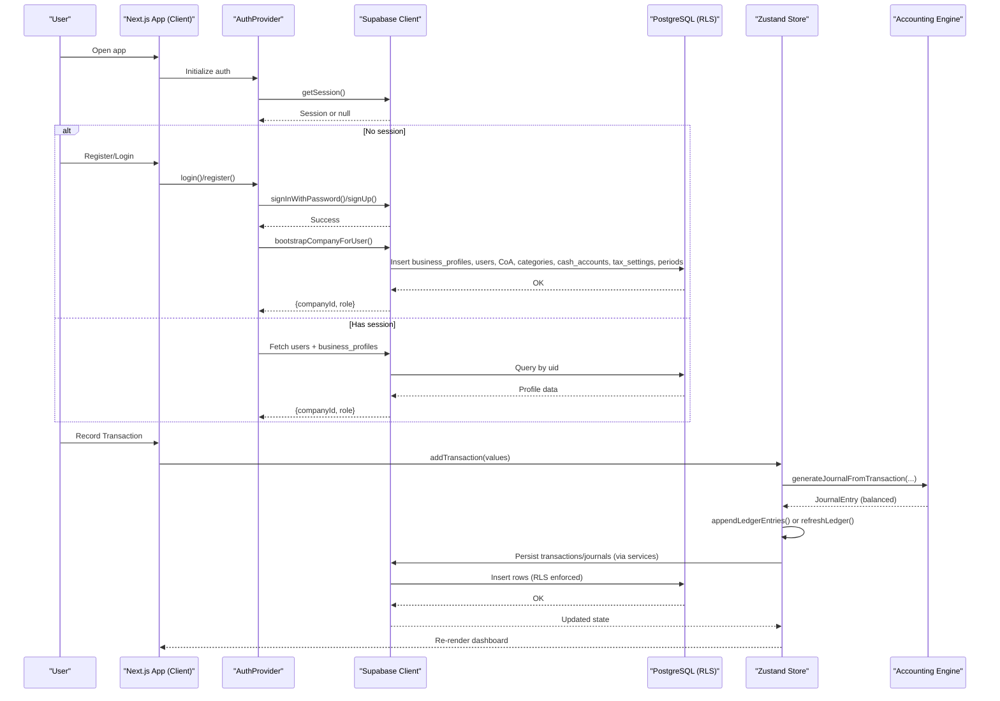
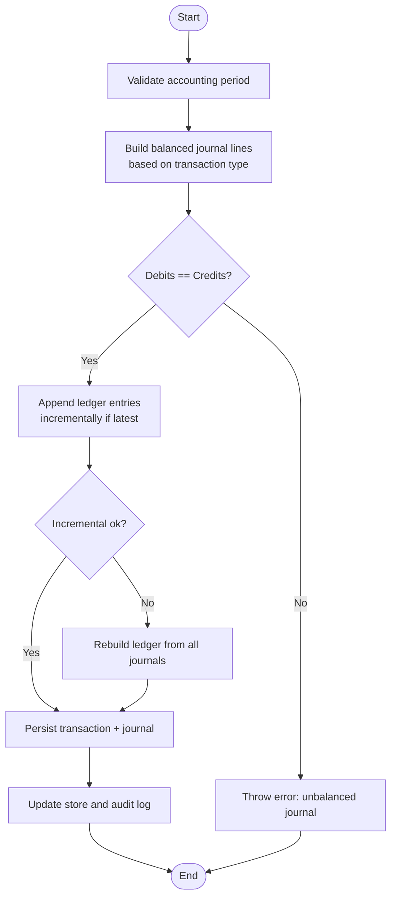
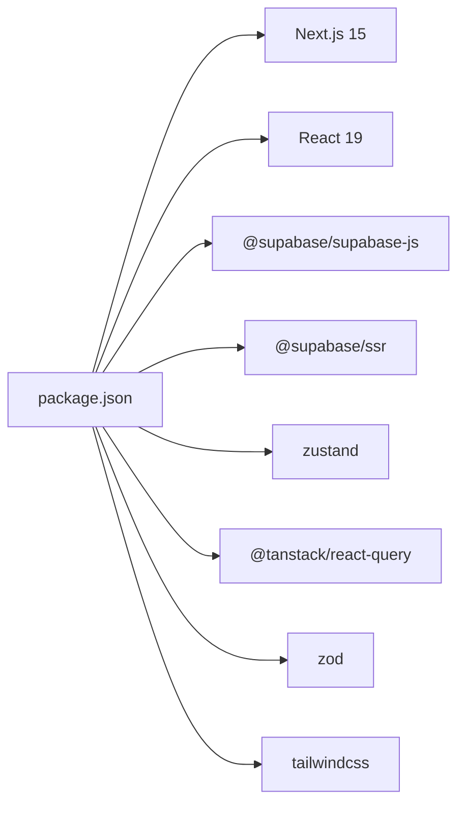

# Getting Started

<cite>
**Referenced Files in This Document**
- [README.md](file://README.md)
- [package.json](file://package.json)
- [supabase-schema.sql](file://supabase-schema.sql)
- [app/layout.tsx](file://app/layout.tsx)
- [components/providers.tsx](file://components/providers.tsx)
- [lib/supabase/client.ts](file://lib/supabase/client.ts)
- [components/auth-provider.tsx](file://components/auth-provider.tsx)
- [lib/supabase/bootstrap.ts](file://lib/supabase/bootstrap.ts)
- [store/use-kasflow-store.ts](file://store/use-kasflow-store.ts)
- [lib/accounting.ts](file://lib/accounting.ts)
- [app/page.tsx](file://app/page.tsx)
- [app/api/callback/route.ts](file://app/api/callback/route.ts)
</cite>

## Table of Contents
1. Introduction
2. Project Structure
3. Core Components
4. Architecture Overview
5. Detailed Component Analysis
6. Dependency Analysis
7. Performance Considerations
8. Troubleshooting Guide
9. Conclusion

## Introduction
KasFlow is a ledger-first accounting application designed for Indonesian MSMEs (UMKM). It automates double-entry bookkeeping: every transaction generates balanced journal entries, which power real-time financial reports such as Profit & Loss, Balance Sheet, and Cash Flow. The system uses Supabase (PostgreSQL + Auth + Realtime) to provide secure, multi-tenant data isolation via Row Level Security (RLS), and a Next.js frontend with client-side rendering for live dashboards.

Key concepts used throughout the codebase:
- Ledger-first: Journal entries are the source of truth; transactions are user-friendly inputs that produce journals.
- Double-entry bookkeeping: Every transaction creates paired debit/credit lines that balance.
- Chart of Accounts (CoA): Standardized account structure aligned with Indonesian accounting practices.

This guide helps both beginners and experienced developers set up KasFlow, understand its architecture, and record your first transactions.

## Project Structure
High-level organization:
- Frontend pages and layout under app/
- Shared UI components under components/
- Accounting logic and helpers under lib/
- Client state and business actions under store/
- Database schema and migrations under supabase-migrations/ and supabase-schema.sql
- API routes for integrations under app/api/

**Diagram sources**
- [app/layout.tsx:1-57](file://app/layout.tsx#L1-L57)
- [components/providers.tsx:1-20](file://components/providers.tsx#L1-L20)
- [components/auth-provider.tsx:1-299](file://components/auth-provider.tsx#L1-L299)
- [lib/supabase/client.ts:1-20](file://lib/supabase/client.ts#L1-L20)
- [lib/supabase/bootstrap.ts:1-199](file://lib/supabase/bootstrap.ts#L1-L199)
- [store/use-kasflow-store.ts:1-800](file://store/use-kasflow-store.ts#L1-L800)
- [lib/accounting.ts:1-800](file://lib/accounting.ts#L1-L800)
- [supabase-schema.sql:1-659](file://supabase-schema.sql#L1-L659)
- [app/api/callback/route.ts:1-249](file://app/api/callback/route.ts#L1-L249)

**Section sources**
- [README.md:1-159](file://README.md#L1-L159)
- [package.json:1-47](file://package.json#L1-L47)

## Core Components
- Authentication and onboarding:
  - AuthProvider manages Supabase Auth sessions, bootstraps company profile, default accounts, categories, cash accounts, tax settings, and an initial accounting period for new users.
- Data layer:
  - Supabase browser client configured for implicit flow and URL session detection.
  - Bootstrap service writes tenant-scoped seed data into PostgreSQL tables.
- Accounting engine:
  - Generates balanced journal entries from transactions, builds ledger balances, computes Profit & Loss and Balance Sheet, and supports period closing.
- Client state:
  - Zustand store orchestrates adding transactions, generating journals, incremental ledger updates, and reporting.
- Dashboard:
  - Loads journal entries, calculates summaries, and renders charts for revenue vs expenses and net cash flow.

**Section sources**
- [components/auth-provider.tsx:1-299](file://components/auth-provider.tsx#L1-L299)
- [lib/supabase/client.ts:1-20](file://lib/supabase/client.ts#L1-L20)
- [lib/supabase/bootstrap.ts:1-199](file://lib/supabase/bootstrap.ts#L1-L199)
- [lib/accounting.ts:1-800](file://lib/accounting.ts#L1-L800)
- [store/use-kasflow-store.ts:1-800](file://store/use-kasflow-store.ts#L1-L800)
- [app/page.tsx:1-600](file://app/page.tsx#L1-L600)

## Architecture Overview
The system follows a ledger-first design:
- Users create transactions (income, expense, transfer, capital).
- The accounting engine converts each transaction into a balanced journal entry.
- Reports and dashboards read from journal entries and chart of accounts.
- Supabase provides authentication, database storage, and row-level security per company.

**Diagram sources**
- [components/auth-provider.tsx:1-299](file://components/auth-provider.tsx#L1-L299)
- [lib/supabase/bootstrap.ts:1-199](file://lib/supabase/bootstrap.ts#L1-L199)
- [store/use-kasflow-store.ts:1-800](file://store/use-kasflow-store.ts#L1-L800)
- [lib/accounting.ts:1-800](file://lib/accounting.ts#L1-L800)
- [supabase-schema.sql:1-659](file://supabase-schema.sql#L1-L659)

## Detailed Component Analysis

### Installation and Setup
- Prerequisites:
  - Node.js 18+ and npm
  - A Supabase project (free tier is sufficient)
- Steps:
  1. Clone the repository and install dependencies.
  2. Create a Supabase project and run the full schema in SQL Editor using the provided schema file.
  3. Configure environment variables for Supabase URL and anon key.
  4. Start the development server and open the local app.

What happens during setup:
- The schema defines core tables (business profiles, users, chart of accounts, categories, cash accounts, customers, suppliers, transactions, journal entries, tax settings, accounting periods, audit logs) plus marketplace-related tables.
- Row Level Security policies ensure data isolation per company.
- Realtime publication is enabled for all relevant tables.

Environment variables:
- NEXT_PUBLIC_SUPABASE_URL
- NEXT_PUBLIC_SUPABASE_ANON_KEY

Optional server-side keys for integrations:
- SUPABASE_SERVICE_ROLE_KEY
- TIKTOK_APP_KEY
- TIKTOK_APP_SECRET

**Section sources**
- [README.md:30-70](file://README.md#L30-L70)
- [supabase-schema.sql:1-659](file://supabase-schema.sql#L1-L659)
- [lib/supabase/client.ts:1-20](file://lib/supabase/client.ts#L1-L20)
- [app/api/callback/route.ts:1-249](file://app/api/callback/route.ts#L1-L249)

### First Login and Company Setup
- Registration:
  - Enter email, password, and business name.
  - On success, the system automatically creates a company profile, links the user, seeds the chart of accounts, categories, cash accounts, tax settings, and an initial accounting period.
- Login:
  - Email/password or Google OAuth.
  - After sign-in, the app loads your company context and redirects to the dashboard.

What gets created for you:
- Business profile and user mapping
- Default chart of accounts (assets, liabilities, equity, revenue, expenses)
- Default categories mapped to accounts
- Default cash accounts (cash, bank)
- Default tax settings and current accounting period

**Section sources**
- [components/auth-provider.tsx:1-299](file://components/auth-provider.tsx#L1-L299)
- [lib/supabase/bootstrap.ts:1-199](file://lib/supabase/bootstrap.ts#L1-L199)
- [lib/accounting.ts:1-120](file://lib/accounting.ts#L1-L120)

### Recording Your First Transactions
Supported transaction types:
- Income: Debit cash/bank, Credit revenue account
- Expense: Debit expense account, Credit cash/bank
- Transfer: Debit destination cash/bank, Credit source cash/bank
- Capital: Setoran (owner contribution), Prive (owner withdrawal), Dividen (dividend)

How it works behind the scenes:
- The store validates the accounting period and constructs a balanced journal entry.
- Ledger balances are updated incrementally when possible; otherwise, they are rebuilt.
- Audit logs capture the action.

Practical example flow:
- Add an income transaction (e.g., sales) linked to a category and cash account.
- The system posts a journal entry and updates the dashboard totals immediately.

**Section sources**
- [store/use-kasflow-store.ts:330-384](file://store/use-kasflow-store.ts#L330-L384)
- [lib/accounting.ts:152-256](file://lib/accounting.ts#L152-L256)
- [app/page.tsx:1-600](file://app/page.tsx#L1-L600)

### Public Interfaces and API Usage Patterns
Authentication endpoints:
- Email/password login and registration are handled through Supabase Auth via the client library.
- Google OAuth login is supported.

Integration callback endpoint:
- GET /api/callback handles TikTok Shop OAuth callback, exchanges authorization code for tokens, fetches authorized shops, persists connection records, and ensures a company profile exists before redirecting back to the app.

Usage patterns:
- Use the Supabase browser client for authenticated reads/writes with RLS applied automatically.
- For server-side operations requiring elevated privileges (e.g., integration callbacks), use the service role key.

**Section sources**
- [components/auth-provider.tsx:234-284](file://components/auth-provider.tsx#L234-L284)
- [app/api/callback/route.ts:1-249](file://app/api/callback/route.ts#L1-L249)
- [lib/supabase/client.ts:1-20](file://lib/supabase/client.ts#L1-L20)

### Accounting Flow: From Transaction Entry to Journal Generation

**Diagram sources**
- [store/use-kasflow-store.ts:330-384](file://store/use-kasflow-store.ts#L330-L384)
- [lib/accounting.ts:152-256](file://lib/accounting.ts#L152-L256)
- [lib/accounting.ts:296-347](file://lib/accounting.ts#L296-L347)

### Conceptual Overview
- Ledger-first approach: Journals are authoritative; transactions are user-facing representations.
- Double-entry bookkeeping: Every transaction produces paired debit/credit lines ensuring balance.
- Chart of Accounts: Hierarchical accounts with normal balances and sections for reporting.
- Period management: Open/closed periods control posting windows and enable closing entries.

[No sources needed since this section doesn't analyze specific files]

## Dependency Analysis
Key runtime dependencies:
- Next.js 15 (App Router)
- React 19
- Supabase JS client and SSR helpers
- Zustand for client state
- TanStack Query for data fetching
- Zod for validation
- Tailwind CSS for styling

**Diagram sources**
- [package.json:1-47](file://package.json#L1-L47)

**Section sources**
- [package.json:1-47](file://package.json#L1-L47)

## Performance Considerations
- Incremental ledger updates: When adding a new journal at the end of time, the store attempts to compute only the new ledger entries instead of rebuilding the entire ledger.
- Memoization: Report calculations and cash flow points are memoized to avoid recomputation on re-renders.
- Realtime sync: All core tables are published to Supabase Realtime for live updates across clients.

Recommendations:
- Keep transactions recent to leverage incremental ledger updates.
- Use date range filters on the dashboard to limit computation scope.
- Ensure indexes defined in the schema are utilized by queries (already included).

**Section sources**
- [store/use-kasflow-store.ts:362-372](file://store/use-kasflow-store.ts#L362-L372)
- [lib/accounting.ts:296-347](file://lib/accounting.ts#L296-L347)
- [supabase-schema.sql:644-659](file://supabase-schema.sql#L644-L659)

## Troubleshooting Guide
Common issues and resolutions:
- Supabase not configured:
  - Symptom: Auth page shows configuration warning.
  - Fix: Ensure NEXT_PUBLIC_SUPABASE_URL and NEXT_PUBLIC_SUPABASE_ANON_KEY are set in .env.local.
- Bootstrap fails after registration:
  - Symptom: Registration succeeds but company profile creation fails.
  - Fix: Check Supabase table permissions and RLS policies; verify schema was applied.
- Cannot post transactions:
  - Symptom: Error about closed accounting period.
  - Fix: Open a new period or adjust the transaction date within an open period.
- Integration callback errors:
  - Symptom: Redirects with error parameters after TikTok OAuth.
  - Fix: Verify SUPABASE_SERVICE_ROLE_KEY, TIKTOK_APP_KEY, and TIKTOK_APP_SECRET; check network connectivity and shop authorization.

Where to look:
- Auth provider initialization and bootstrap logic
- Store transaction posting and period checks
- Callback route error handling and redirects

**Section sources**
- [components/auth-provider.tsx:1-299](file://components/auth-provider.tsx#L1-L299)
- [lib/supabase/bootstrap.ts:1-199](file://lib/supabase/bootstrap.ts#L1-L199)
- [store/use-kasflow-store.ts:600-665](file://store/use-kasflow-store.ts#L600-L665)
- [app/api/callback/route.ts:1-249](file://app/api/callback/route.ts#L1-L249)

## Conclusion
KasFlow’s ledger-first design ensures accurate, auditable accounting for Indonesian MSMEs. With automated double-entry journaling, robust tenant isolation, and real-time dashboards, it simplifies financial tracking while remaining extensible for marketplace integrations. Follow the installation steps, complete your first login and company setup, and start recording transactions to see instant insights across your financial statements.