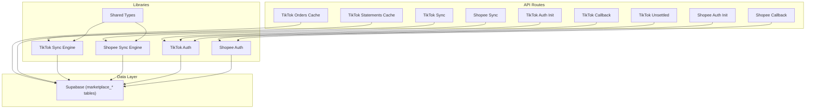
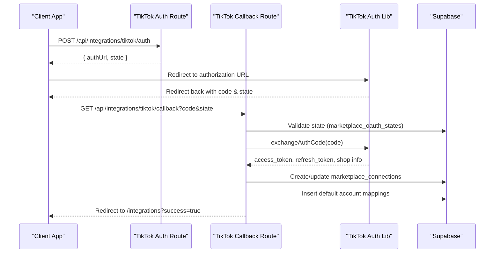
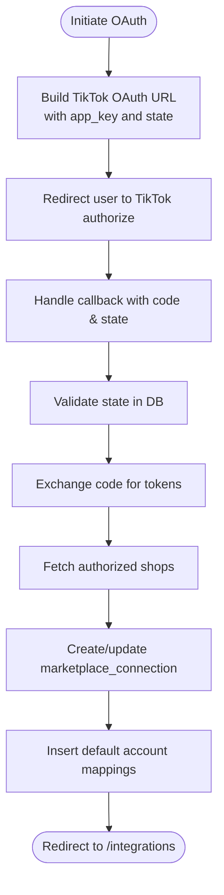
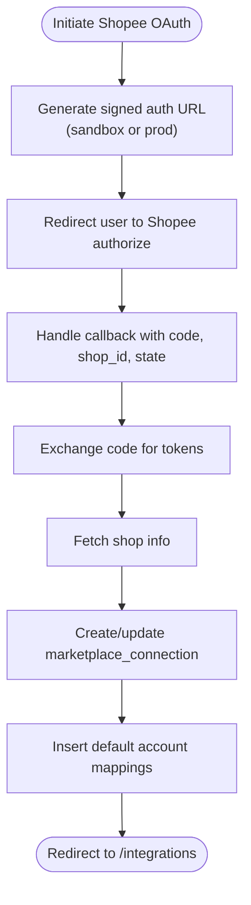
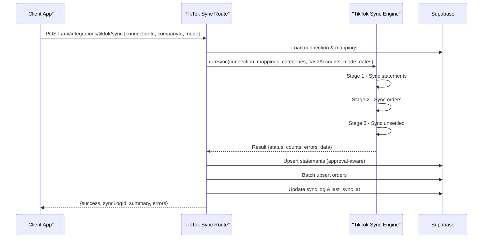
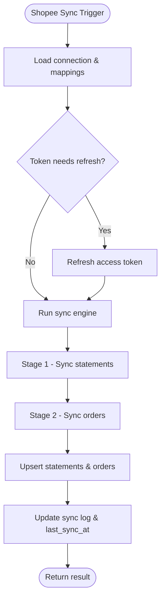
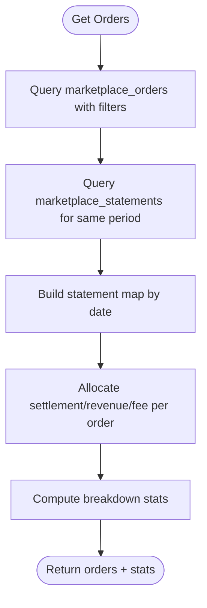
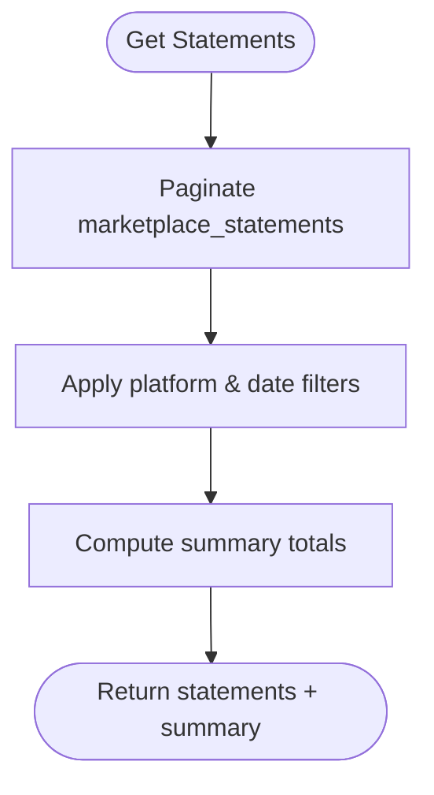
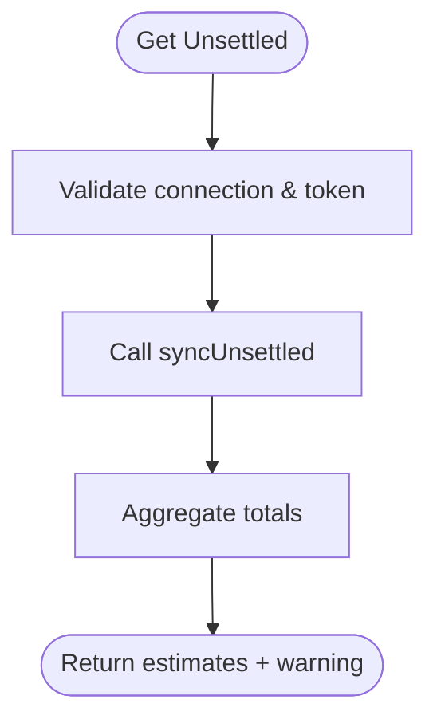
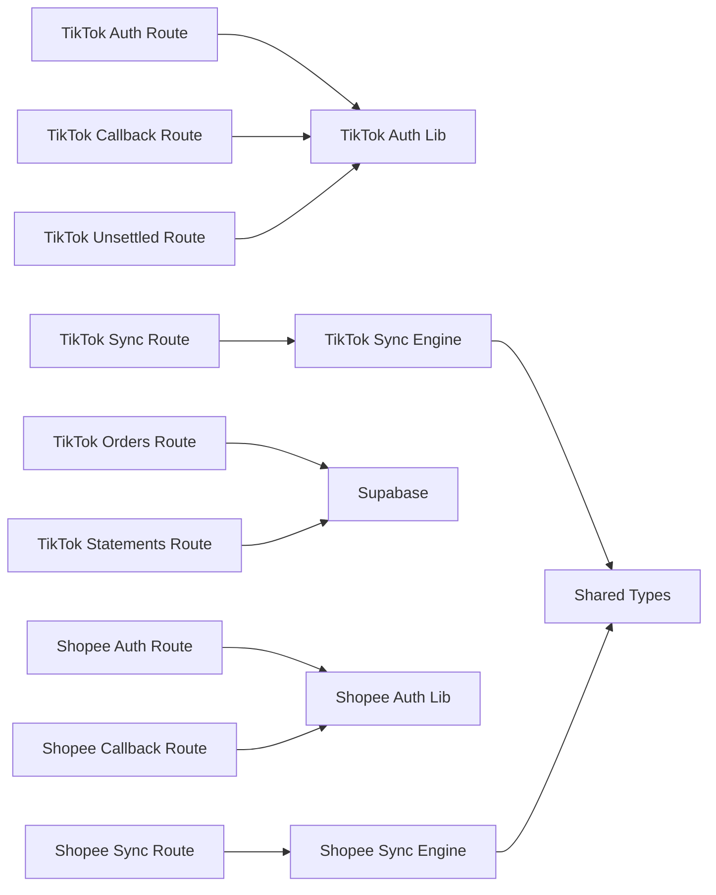

# Marketplace Integration

<cite>
**Referenced Files in This Document**
- [auth/route.ts](file://app/api/integrations/tiktok/auth/route.ts)
- [callback/route.ts](file://app/api/integrations/tiktok/callback/route.ts)
- [orders/route.ts](file://app/api/integrations/tiktok/orders/route.ts)
- [sync/route.ts](file://app/api/integrations/tiktok/sync/route.ts)
- [statements/route.ts](file://app/api/integrations/tiktok/statements/route.ts)
- [unsettled/route.ts](file://app/api/integrations/tiktok/unsettled/route.ts)
- [shopee/auth/route.ts](file://app/api/integrations/shopee/auth/route.ts)
- [shopee/callback/route.ts](file://app/api/integrations/shopee/callback/route.ts)
- [shopee/sync/route.ts](file://app/api/integrations/shopee/sync/route.ts)
- [tiktok/auth.ts](file://lib/marketplace/tiktok/auth.ts)
- [tiktok/sync-engine.ts](file://lib/marketplace/tiktok/sync-engine.ts)
- [shopee/auth.ts](file://lib/marketplace/shopee/auth.ts)
- [shopee/sync-engine.ts](file://lib/marketplace/shopee/sync-engine.ts)
- [types.ts](file://lib/types.ts)
</cite>

## Table of Contents
1. Introduction
2. Project Structure
3. Core Components
4. Architecture Overview
5. Detailed Component Analysis
6. Dependency Analysis
7. Performance Considerations
8. Troubleshooting Guide
9. Conclusion

## Introduction
This document explains the marketplace integration system that connects external e-commerce platforms (TikTok Shop and Shopee) to the internal accounting system. It serves as a bridge between marketplace APIs and KasFlow’s transaction processing and approval workflows, enabling:
- Secure marketplace connection via OAuth
- Periodic data synchronization through a sync engine
- Statement reconciliation and settlement matching
- Approval workflow for financial entries

The content is designed for both beginners setting up marketplace connections and experienced developers extending integrations.

## Project Structure
The integration is implemented as Next.js API routes with platform-specific handlers and shared library modules for authentication, client calls, and sync orchestration.

**Diagram sources**
- [auth/route.ts:1-46](file://app/api/integrations/tiktok/auth/route.ts#L1-L46)
- [callback/route.ts:1-200](file://app/api/integrations/tiktok/callback/route.ts#L1-L200)
- [sync/route.ts:1-454](file://app/api/integrations/tiktok/sync/route.ts#L1-L454)
- [orders/route.ts:1-257](file://app/api/integrations/tiktok/orders/route.ts#L1-L257)
- [statements/route.ts:1-161](file://app/api/integrations/tiktok/statements/route.ts#L1-L161)
- [unsettled/route.ts:1-91](file://app/api/integrations/tiktok/unsettled/route.ts#L1-L91)
- [shopee/auth/route.ts:1-55](file://app/api/integrations/shopee/auth/route.ts#L1-L55)
- [shopee/callback/route.ts:1-196](file://app/api/integrations/shopee/callback/route.ts#L1-L196)
- [shopee/sync/route.ts:1-430](file://app/api/integrations/shopee/sync/route.ts#L1-L430)
- [tiktok/auth.ts:1-180](file://lib/marketplace/tiktok/auth.ts#L1-L180)
- [tiktok/sync-engine.ts:1-282](file://lib/marketplace/tiktok/sync-engine.ts#L1-L282)
- [shopee/auth.ts:1-128](file://lib/marketplace/shopee/auth.ts#L1-L128)
- [shopee/sync-engine.ts:1-237](file://lib/marketplace/shopee/sync-engine.ts#L1-L237)
- [types.ts:268-423](file://lib/types.ts#L268-L423)

**Section sources**
- [auth/route.ts:1-46](file://app/api/integrations/tiktok/auth/route.ts#L1-L46)
- [callback/route.ts:1-200](file://app/api/integrations/tiktok/callback/route.ts#L1-L200)
- [sync/route.ts:1-454](file://app/api/integrations/tiktok/sync/route.ts#L1-L454)
- [orders/route.ts:1-257](file://app/api/integrations/tiktok/orders/route.ts#L1-L257)
- [statements/route.ts:1-161](file://app/api/integrations/tiktok/statements/route.ts#L1-L161)
- [unsettled/route.ts:1-91](file://app/api/integrations/tiktok/unsettled/route.ts#L1-L91)
- [shopee/auth/route.ts:1-55](file://app/api/integrations/shopee/auth/route.ts#L1-L55)
- [shopee/callback/route.ts:1-196](file://app/api/integrations/shopee/callback/route.ts#L1-L196)
- [shopee/sync/route.ts:1-430](file://app/api/integrations/shopee/sync/route.ts#L1-L430)
- [tiktok/auth.ts:1-180](file://lib/marketplace/tiktok/auth.ts#L1-L180)
- [tiktok/sync-engine.ts:1-282](file://lib/marketplace/tiktok/sync-engine.ts#L1-L282)
- [shopee/auth.ts:1-128](file://lib/marketplace/shopee/auth.ts#L1-L128)
- [shopee/sync-engine.ts:1-237](file://lib/marketplace/shopee/sync-engine.ts#L1-L237)
- [types.ts:268-423](file://lib/types.ts#L268-L423)

## Core Components
- Marketplace Connection: Represents an authenticated link between a company and a marketplace shop, including tokens and metadata.
- Sync Engine: Orchestrates fetching statements, orders, and unsettled transactions from marketplaces and persists them into the database.
- Settlement Reconciliation: Maps platform statements to revenue, fees, adjustments, and shipping costs; supports proportional allocation across orders.
- Approval Workflow: New statements are created with pending_approval status; users can approve or reject before further processing.

Key responsibilities:
- Authentication: OAuth flows for TikTok Shop and Shopee, token refresh strategies, and state validation.
- Data Synchronization: Incremental/full/backfill modes, batched upserts, and error logging.
- Accounting Integration: Creation of KasFlow transactions and journals based on mappings and categories.

**Section sources**
- [types.ts:268-423](file://lib/types.ts#L268-L423)
- [tiktok/sync-engine.ts:1-282](file://lib/marketplace/tiktok/sync-engine.ts#L1-L282)
- [shopee/sync-engine.ts:1-237](file://lib/marketplace/shopee/sync-engine.ts#L1-L237)
- [tiktok/auth.ts:1-180](file://lib/marketplace/tiktok/auth.ts#L1-L180)
- [shopee/auth.ts:1-128](file://lib/marketplace/shopee/auth.ts#L1-L128)

## Architecture Overview
The system follows a layered architecture:
- API Layer: Platform-specific route handlers for OAuth initiation, callbacks, sync triggers, and cached data retrieval.
- Library Layer: Shared logic for OAuth, client calls, and sync orchestration per platform.
- Data Layer: Supabase tables for connections, statements, orders, sync logs, and account mappings.

**Diagram sources**
- [auth/route.ts:1-46](file://app/api/integrations/tiktok/auth/route.ts#L1-L46)
- [callback/route.ts:1-200](file://app/api/integrations/tiktok/callback/route.ts#L1-L200)
- [tiktok/auth.ts:1-180](file://lib/marketplace/tiktok/auth.ts#L1-L180)

## Detailed Component Analysis

### TikTok Shop OAuth Flow
Purpose: Establish a secure marketplace connection by exchanging an authorization code for access tokens and persisting connection details.

Key steps:
- Initiate OAuth: Build authorization URL with app key and state.
- Handle callback: Validate state, exchange code for tokens, fetch authorized shops, create or update connection, insert default account mappings, redirect to integrations page.

**Diagram sources**
- [auth/route.ts:1-46](file://app/api/integrations/tiktok/auth/route.ts#L1-L46)
- [callback/route.ts:1-200](file://app/api/integrations/tiktok/callback/route.ts#L1-L200)
- [tiktok/auth.ts:1-180](file://lib/marketplace/tiktok/auth.ts#L1-L180)

**Section sources**
- [auth/route.ts:1-46](file://app/api/integrations/tiktok/auth/route.ts#L1-L46)
- [callback/route.ts:1-200](file://app/api/integrations/tiktok/callback/route.ts#L1-L200)
- [tiktok/auth.ts:1-180](file://lib/marketplace/tiktok/auth.ts#L1-L180)

### Shopee OAuth Flow
Purpose: Connect Shopee shops using partner credentials and handle sandbox vs production environments.

Key steps:
- Initiate OAuth: Generate signed authorization URL (sandbox uses different domain).
- Handle callback: Exchange code for tokens, fetch shop info, create or update connection, insert default account mappings, redirect to integrations page.

**Diagram sources**
- [shopee/auth/route.ts:1-55](file://app/api/integrations/shopee/auth/route.ts#L1-L55)
- [shopee/callback/route.ts:1-196](file://app/api/integrations/shopee/callback/route.ts#L1-L196)
- [shopee/auth.ts:1-128](file://lib/marketplace/shopee/auth.ts#L1-L128)

**Section sources**
- [shopee/auth/route.ts:1-55](file://app/api/integrations/shopee/auth/route.ts#L1-L55)
- [shopee/callback/route.ts:1-196](file://app/api/integrations/shopee/callback/route.ts#L1-L196)
- [shopee/auth.ts:1-128](file://lib/marketplace/shopee/auth.ts#L1-L128)

### Sync Engine Orchestration
Purpose: Coordinate multi-stage synchronization for statements, orders, and unsettled transactions, with token refresh and approval-aware persistence.

Key behaviors:
- Determine sync start date based on mode (full/incremental/backfill) and last_sync_at.
- Stage 1: Sync statements (create KasFlow transactions), map payment statuses, preserve approval_status for existing records.
- Stage 2: Sync orders (cache for analytics), batch upserts with conflict handling.
- Stage 3: Sync unsettled (estimates only), optional stage.
- Update sync logs and connection last_sync_at.

**Diagram sources**
- [sync/route.ts:1-454](file://app/api/integrations/tiktok/sync/route.ts#L1-L454)
- [tiktok/sync-engine.ts:1-282](file://lib/marketplace/tiktok/sync-engine.ts#L1-L282)

**Section sources**
- [sync/route.ts:1-454](file://app/api/integrations/tiktok/sync/route.ts#L1-L454)
- [tiktok/sync-engine.ts:1-282](file://lib/marketplace/tiktok/sync-engine.ts#L1-L282)

### Shopee Sync Engine
Purpose: Similar orchestration for Shopee, focusing on payout release details and order caching.

Key differences:
- Token refresh threshold is shorter (30 minutes).
- Payment status mapping defaults to PAID for released payouts.
- Order fields include buyerUserId and shippingProvider.

**Diagram sources**
- [shopee/sync/route.ts:1-430](file://app/api/integrations/shopee/sync/route.ts#L1-L430)
- [shopee/sync-engine.ts:1-237](file://lib/marketplace/shopee/sync-engine.ts#L1-L237)

**Section sources**
- [shopee/sync/route.ts:1-430](file://app/api/integrations/shopee/sync/route.ts#L1-L430)
- [shopee/sync-engine.ts:1-237](file://lib/marketplace/shopee/sync-engine.ts#L1-L237)

### Order Synchronization and Proportional Settlement
Purpose: Provide cached order data with proportional settlement allocation based on daily statement totals.

Key logic:
- Query orders with filters (connection, platform, date range, status).
- Aggregate statements by date to compute total settlement, revenue, and fee.
- Allocate amounts proportionally per order based on total_amount ratio.

**Diagram sources**
- [orders/route.ts:1-257](file://app/api/integrations/tiktok/orders/route.ts#L1-L257)

**Section sources**
- [orders/route.ts:1-257](file://app/api/integrations/tiktok/orders/route.ts#L1-L257)

### Statement Processing and Approval Workflow
Purpose: Retrieve statements with summaries and support approval workflow states.

Key features:
- Paginated queries with platform and date filters.
- Summary totals for revenue, fees, settlements, adjustments, reconciled count, and pending approvals.
- Approval status preserved during updates; new statements set to pending_approval.

**Diagram sources**
- [statements/route.ts:1-161](file://app/api/integrations/tiktok/statements/route.ts#L1-L161)

**Section sources**
- [statements/route.ts:1-161](file://app/api/integrations/tiktok/statements/route.ts#L1-L161)

### Unsettled Transactions Estimation
Purpose: Fetch unsettled estimates from TikTok for visibility and planning.

Key behavior:
- Validates active connection and token expiry.
- Calls unsettled sync utility to aggregate estimated settlement, revenue, and fees.
- Returns warning that data is preliminary until final settlement.

**Diagram sources**
- [unsettled/route.ts:1-91](file://app/api/integrations/tiktok/unsettled/route.ts#L1-L91)

**Section sources**
- [unsettled/route.ts:1-91](file://app/api/integrations/tiktok/unsettled/route.ts#L1-L91)

## Dependency Analysis
The integration relies on clear separation between API routes and library modules, minimizing coupling and enhancing testability.

**Diagram sources**
- [auth/route.ts:1-46](file://app/api/integrations/tiktok/auth/route.ts#L1-L46)
- [callback/route.ts:1-200](file://app/api/integrations/tiktok/callback/route.ts#L1-L200)
- [sync/route.ts:1-454](file://app/api/integrations/tiktok/sync/route.ts#L1-L454)
- [orders/route.ts:1-257](file://app/api/integrations/tiktok/orders/route.ts#L1-L257)
- [statements/route.ts:1-161](file://app/api/integrations/tiktok/statements/route.ts#L1-L161)
- [unsettled/route.ts:1-91](file://app/api/integrations/tiktok/unsettled/route.ts#L1-L91)
- [shopee/auth/route.ts:1-55](file://app/api/integrations/shopee/auth/route.ts#L1-L55)
- [shopee/callback/route.ts:1-196](file://app/api/integrations/shopee/callback/route.ts#L1-L196)
- [shopee/sync/route.ts:1-430](file://app/api/integrations/shopee/sync/route.ts#L1-L430)
- [tiktok/auth.ts:1-180](file://lib/marketplace/tiktok/auth.ts#L1-L180)
- [tiktok/sync-engine.ts:1-282](file://lib/marketplace/tiktok/sync-engine.ts#L1-L282)
- [shopee/auth.ts:1-128](file://lib/marketplace/shopee/auth.ts#L1-L128)
- [shopee/sync-engine.ts:1-237](file://lib/marketplace/shopee/sync-engine.ts#L1-L237)
- [types.ts:268-423](file://lib/types.ts#L268-L423)

**Section sources**
- [types.ts:268-423](file://lib/types.ts#L268-L423)
- [tiktok/sync-engine.ts:1-282](file://lib/marketplace/tiktok/sync-engine.ts#L1-L282)
- [shopee/sync-engine.ts:1-237](file://lib/marketplace/shopee/sync-engine.ts#L1-L237)

## Performance Considerations
- Batched upserts: Orders are upserted in batches to reduce database load and improve throughput.
- Incremental sync: Uses last_sync_at to limit data fetched, reducing API calls and processing time.
- Token refresh thresholds: Proactive refresh prevents expired token errors during long-running operations.
- Server-side filtering: Date and status filters applied at the database level to minimize payload sizes.
- Pagination: Queries use range-based pagination to avoid large responses.

[No sources needed since this section provides general guidance]

## Troubleshooting Guide
Common issues and resolutions:
- Invalid or expired state: Ensure state is validated and not reused; check marketplace_oauth_states table.
- Missing environment variables: Verify app keys, partner IDs, and redirect URIs are configured correctly.
- Token refresh failures: If refresh fails and token is expired, prompt reconnection; otherwise continue with existing token if still valid.
- Statement approval conflicts: Rejected statements are skipped during updates; review approval_status and rejected_reason.
- Sync errors: Inspect marketplace_sync_logs for detailed error messages and stage-specific failures.

**Section sources**
- [callback/route.ts:1-200](file://app/api/integrations/tiktok/callback/route.ts#L1-L200)
- [shopee/callback/route.ts:1-196](file://app/api/integrations/shopee/callback/route.ts#L1-L196)
- [sync/route.ts:1-454](file://app/api/integrations/tiktok/sync/route.ts#L1-L454)
- [shopee/sync/route.ts:1-430](file://app/api/integrations/shopee/sync/route.ts#L1-L430)

## Conclusion
The marketplace integration system provides a robust foundation for connecting TikTok Shop and Shopee to the internal accounting system. With secure OAuth flows, efficient sync engines, and careful handling of approvals and settlements, it enables accurate financial reporting and reconciliation. The modular design supports extension to additional marketplaces while maintaining consistency in data transformation and workflow processes.

[No sources needed since this section summarizes without analyzing specific files]